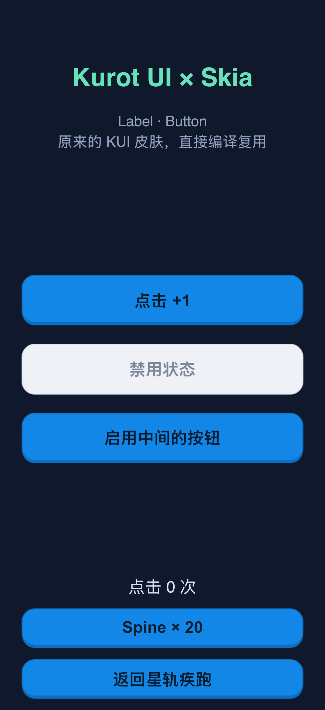
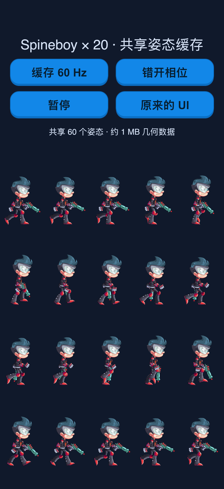
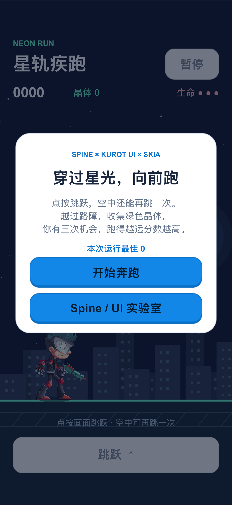
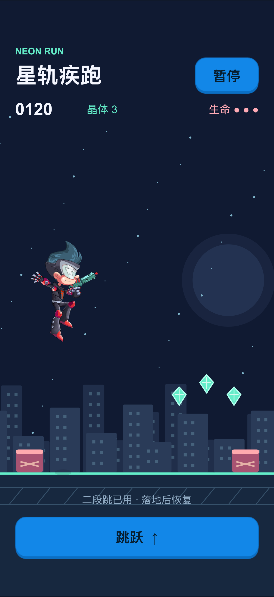
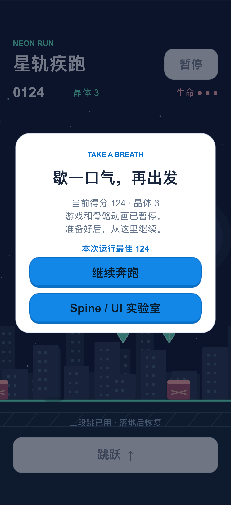
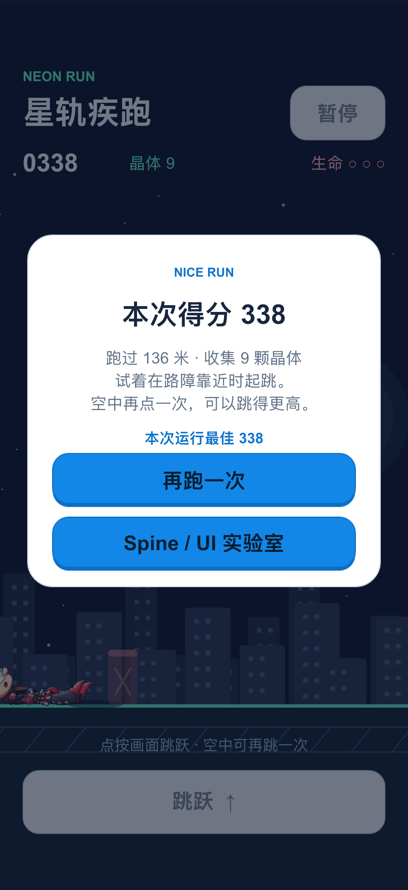

# 示例截图

以下画面来自 **2026-10-11 的 iOS Release 模拟器验收**：iPhone 17 Pro / iOS 26.5，
当前游戏的生产 JS，原生宿主为 Skia 3.3.0。所有 PNG 保留原始 1206×2622 像素，未裁切或缩放。
环境、捕获时间与 SHA-256 见 [capture.json](screenshots/capture.json)，测试范围见[验证记录](verification.md)。

## Kurot UI

Label、Button、中文文字和原有 KUI 按钮皮肤在 Skia 中直接绘制。
蓝色按钮可计数，中间按钮演示禁用状态，底部可以切换 Spine ×20 或返回游戏。
对应源码：[UIShowcase.ts](../src/game/UIShowcase.ts)。

## Spine ×20

20 个 Spineboy 共享 60 个 `walk` 姿态，各自保留错开的播放相位。
可切换实时骨骼、同步相位和暂停。画面的「60 Hz」表示姿态采样率。
对应源码：[SpineShowcase.ts](../src/game/SpineShowcase.ts)。

## 星轨疾跑

Spine 主角、Graphics 城市/路障/晶体与 KUI HUD 组成完整跑酷示例。
点按画面或按钮跳跃，空中可再跳一次；晶体加分，碰撞消耗生命，支持暂停与重开。
对应源码：[runner](../src/game/runner/)，皮肤：[RunnerSkin.kui.xml](../resource/ui/skins/RunnerSkin.kui.xml)。

### 开始菜单

菜单说明玩法，并保留前往实验室的入口。HUD、面板和按钮均来自 XML 皮肤。

### 游玩与二段跳

角色使用原 SDK 实时骨骼，物理控制跳跃高度；下方绿色晶体和粉色路障由 Graphics 绘制。

### 暂停

暂停同时冻结物理和骨骼，点击「继续奔跑」恢复。
间隔约 3 秒的[另一张暂停截图](screenshots/neon-run-paused-later.png)与这张文件完全一致。

### 结算

本次验收一局得到 338 分、收集 9 颗晶体，可以立即重开或切换实验室。

### 其他验收画面

| 画面 | 检查点 |
| --- | --- |
| [重开后奔跑](screenshots/neon-run-restarted.png) | 生命恢复为三条，晶体清零，重新计分 |
| [从实验室返回](screenshots/neon-run-returned.png) | 回到开始菜单，本次运行最佳分数仍为 338 |
| [暂停约 3 秒后](screenshots/neon-run-paused-later.png) | PNG 与首次暂停完全一致 |

截图共 9 张，来自同一次通过的 XCTest 交互流程。Spine 素材授权信息保存在
[resource/spine/LICENSE](../resource/spine/LICENSE)。
